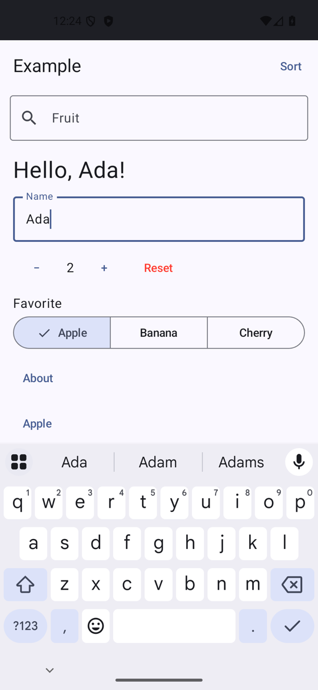

# AndroidAppRuntime

The Android host for [AppRuntime](https://github.com/PureSwift/AppRuntime)
apps. An AppRuntime app is guest code only: a universal bundle with
`App.wasm` and native `libapp.a` slices. This repository will turn one into
an Android app:

- the **host runtime**, in Swift: the Activity shell, the main looper, the
  runtime core behind `rt.h`, and the contract implementations over the
  Android SDK. Each contract module is Swift over a small Kotlin class, bound
  with [swift-java](https://github.com/swiftlang/swift-java); Motion reads
  the NDK's sensors directly;
- the **SwiftUI player**: [AndroidSwiftUI](https://github.com/PureSwift/AndroidSwiftUI)'s
  Compose interpreter, behind an adapter for AppRuntime's render IR;
- the **packager**, `android-app`, which turns a universal bundle into a
  signed APK or App Bundle.

**Status:** phase 4 of the [plan](Documentation/Plan.md): `android-app` can
run an app from its `App.wasm` through wasm2c, location updates continue in
the background, the bundle's images become drawables, and
`Scripts/example-ui.sh --accessibility` audits screens for TalkBack. In
phase 3 every AppRuntime contract module came to Android, checked on the
emulator by `Scripts/contracts-check.sh`; in phase 2, `android-app` packaged
a universal bundle as a debug APK, or as a signed release APK or App Bundle.
Before that, in phase 1: AppRuntime's `ExampleUI` runs from its universal
bundle in the emulator, rendered by AndroidSwiftUI's composeui. Taps,
typing, the lazy list, navigation and the back gesture all reach the guest
and come back.



Phase 0 ran AppRuntime's `ExampleApp` from its sealed Android slice, with
every check of AppRuntime's linked-slice test passing.

It is the counterpart of
[DarwinAppRuntime](https://github.com/PureSwift/DarwinAppRuntime) and
[LinuxAppRuntime](https://github.com/PureSwift/LinuxAppRuntime).

## Building

Swift 6.4 is required (`.swift-version` pins 6.4.2), with the Swift SDK
for Android set up with NDK r30. Its runtime needs r30's `libc++_shared.so`,
although its setup script accepts r27:

```sh
swift sdk install https://download.swift.org/swift-6.4.2-release/android-sdk/swift-6.4.2-RELEASE/swift-6.4.2-RELEASE_android.artifactbundle.tar.gz \
    --checksum 4d6ad63ea74becd58e123ff58b1b48c3be5ec0db0dff0ea5abe37ac007dd3233
ANDROID_NDK_HOME=~/Library/Android/sdk/ndk/30.0.16248370 \
    ~/Library/org.swift.swiftpm/swift-sdks/swift-6.4.2-RELEASE_android.artifactbundle/swift-android/scripts/setup-android-sdk.sh
```

Then, with an emulator running and these checkouts next to this one:

- AppRuntime, with its `RuntimeHost` module (or `APPRUNTIME_PATH`);
- AndroidSwiftUI, for composeui (or `ANDROIDSWIFTUI_PATH`).

```sh
Scripts/example-ui.sh --run
```

The script:

- builds `ExampleUI`'s universal bundle with AppRuntime's `guest.py`;
- links its slice into `libapp.so` with the host;
- builds `Android/example-ui` with Gradle, on a JDK from 17 to 21;
- installs it, and drives it with UI Automator
  (`Scripts/example-ui-check.py`).

It uses a running emulator unless `ANDROID_SERIAL` names a device. With
`--accessibility`, the check also audits each screen for TalkBack: every
control has a label, none is two stops, targets are at least 48 dp, and
images have descriptions.
`Scripts/example-app.sh --run` does the same for phase 0.

## Contracts

The host implements AppRuntime's contract modules: Device, Formatting,
Location, Networking, Bluetooth (the central role), Motion and NFC (the
reader role), and the `Permissions` built-in over Android's runtime
permissions.

```sh
Scripts/contracts-check.sh
```

The script builds `Examples/ContractsCheck`, a guest app that calls every
contract and shows one `ok` or `FAIL` line per check, and packages it with
`android-app run`. `Scripts/contracts-check.py` then reads the lines from
the player's trace in logcat, and makes things happen for the app to see:

- it changes the emulator's battery and GPS position;
- it answers the location, Nearby devices and physical activity prompts.

Last, it picks "Allow all the time" for the app's location, checks the
host's foreground service runs, and moves the GPS with the app in the
background. `--engine wasm2c` runs the same checks from the app's
`App.wasm`, translated to C (it needs WABT: `brew install wabt`).

Networking's checks need the Internet (httpbin.org). Bluetooth scans, and
connects to the first connectable device it finds, if any. NFC needs a
device with NFC; on the emulator, the check confirms the session fails as it
should.

## Packaging

`android-app` turns a universal bundle from AppRuntime's `guest.py bundle`
into an Android app:

```sh
swift run android-app validate App.app
```

```sh
swift run android-app run App.app
```

```sh
ANDROID_KEYSTORE_PASSWORD=… swift run android-app package App.app --aab --keystore release.jks --alias release
```

- `validate` checks the app against this host: its keys, its contracts and
  its slices.
- `run` builds a debug APK, installs it on a running emulator (or
  `--device`), and starts it.
- `package` builds a debug APK, or a signed release with `--release` or
  `--aab`. Release passwords come from `ANDROID_KEYSTORE_PASSWORD` and
  `ANDROID_KEY_PASSWORD`.
- `gradle` writes the app's Gradle project, for Android Studio.

Each ABI the bundle has a slice for is built, unless `--abi` picks some.
An ABI without a slice is made from the bundle's `App.wasm` with wasm2c;
`--engine native` or `--engine wasm2c` chooses for every ABI. wasm2c needs
WABT (`brew install wabt`) and AppRuntime's checkout, for its shim
(`--appruntime`, `APPRUNTIME_PATH`, or one next to this one). The work goes
in `.build/android-app/<identifier>/`.

The bundle's images (`resources/**` PNG, JPEG, WebP and GIF, with `@2x` and
`@3x` variants) become Android drawables, so `Image("Logo")` finds them.
`location(.always)` gets the host's foreground service, which keeps
location updates going in the background.

## Tests

`swift test` runs the host's and the packager's unit tests on macOS. Run the player's tests
from `Android/`:

```sh
./gradlew :appruntime-ui:desktopTest
```
