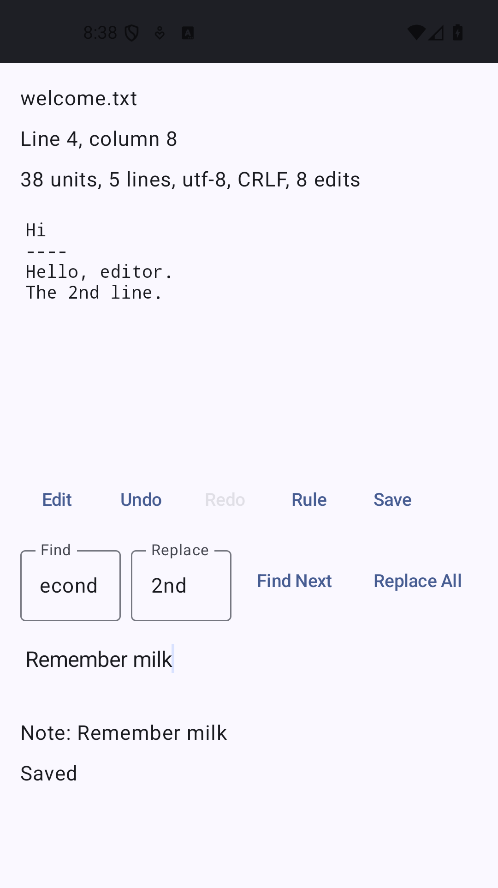
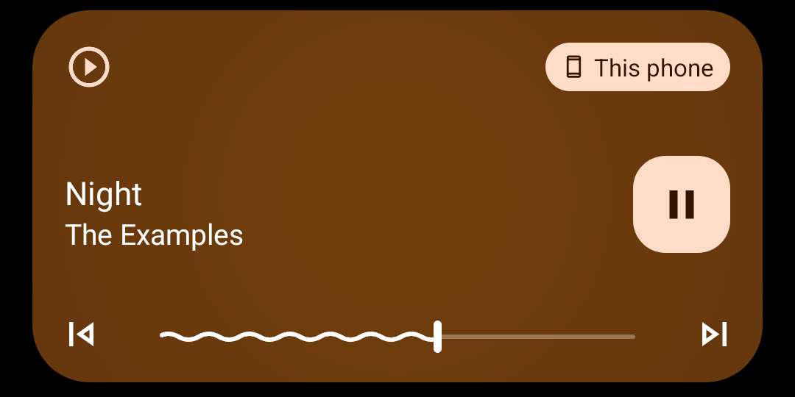
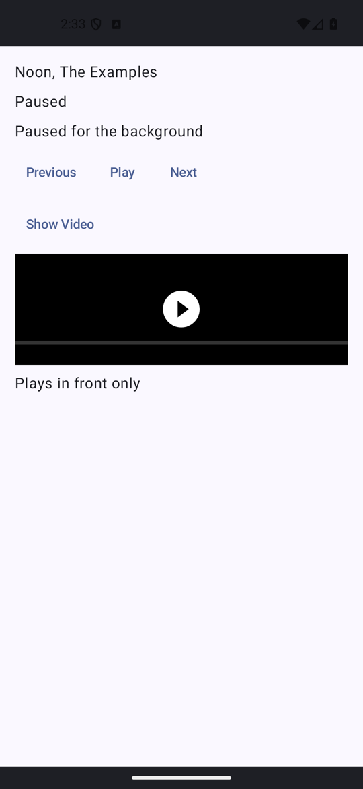
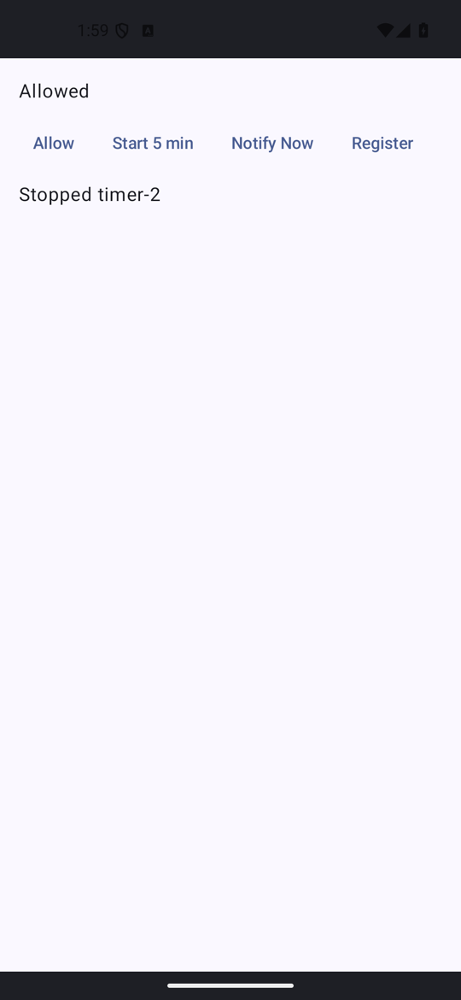
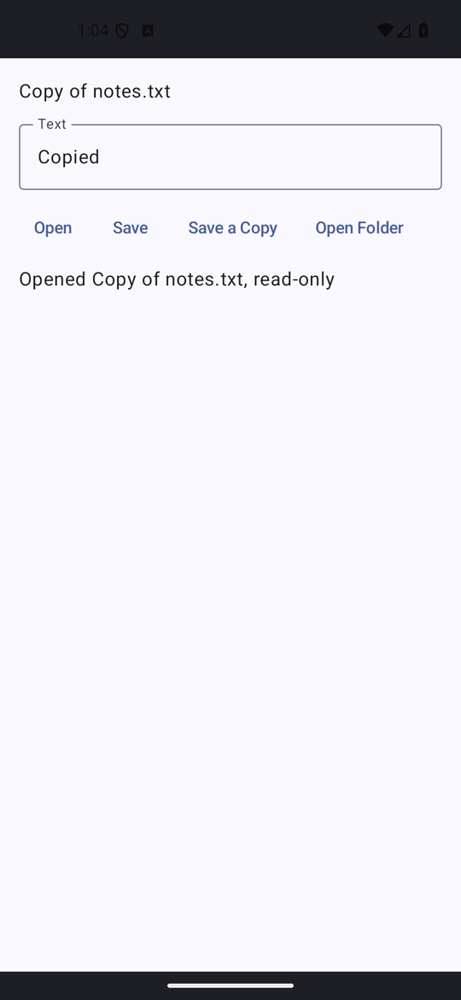
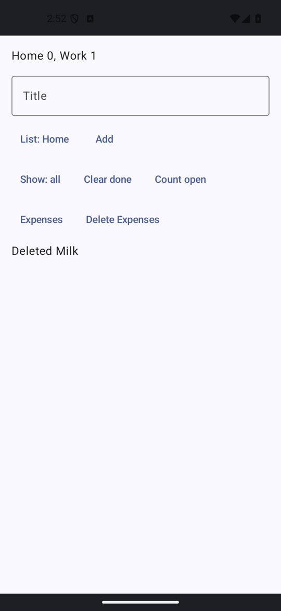
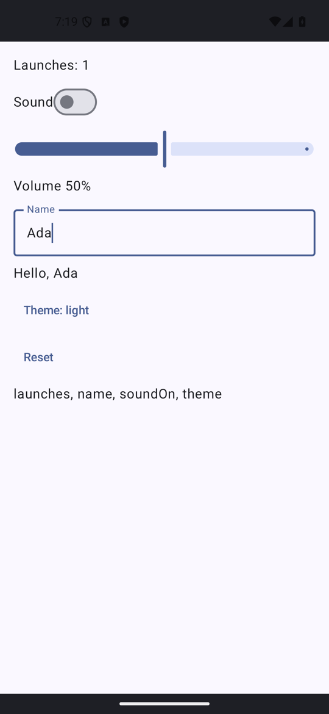
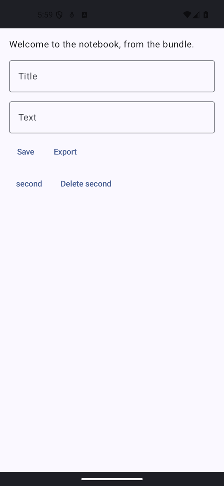
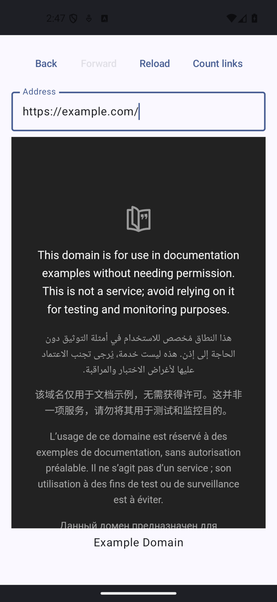
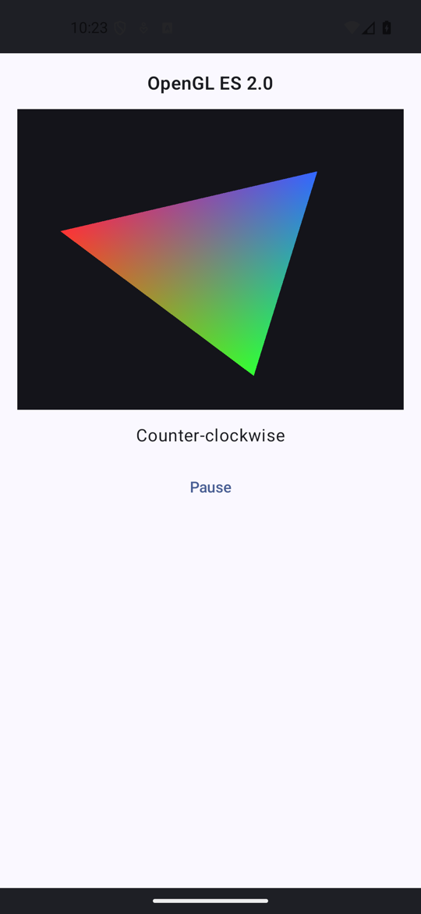

# AndroidAppRuntime

The Android host for [AppRuntime](https://github.com/PureSwift/AppRuntime)
apps. An AppRuntime app is guest code only: a universal bundle with
`App.wasm` and native `libapp.a` slices. This repository will turn one into
an Android app:

- the **host runtime**, in Swift: the Activity shell, the main looper, the
  runtime core behind `rt.h`, and the contract implementations over the
  Android SDK. Each contract module is Swift over a small Kotlin class, bound
  with [swift-java](https://github.com/swiftlang/swift-java); Motion reads
  the NDK's sensors directly, and surfaces draw with EGL from Swift;
- the **SwiftUI player**: [AndroidSwiftUI](https://github.com/PureSwift/AndroidSwiftUI)'s
  Compose interpreter, behind an adapter for AppRuntime's render IR;
- the **packager**, `android-app`, which turns a universal bundle into a
  signed APK or App Bundle.

**Status:** text: an app can hold a text in an `EditText` the user types
in, and load and save it, read and change it, find and replace in it,
undo and redo, and give it the keyboard with `@FocusState`. AppRuntime's
`ExampleText` runs on the emulator.



Before that, calendars: an app can read the user's calendars, list what
happens in a month as Android expands it, and add, move and cancel events,
one occurrence or the rest of a series, through `CalendarContract`.
AppRuntime's `ExampleCalendar` runs on the emulator.

Before that, contacts: an app can read the user's address book, find
people by name with Android's own search, and add, change and remove
them, through `ContactsContract`. AppRuntime's `ExampleContacts` runs on
the emulator.

Before that, now playing: an app says what it plays, and Android shows it
with its buttons in the notification shade, on the lock screen and to
headphones, through a Media3 `MediaSession`; where its manifest says so,
it plays on in the background. AppRuntime's `ExampleMedia` plays on on the
emulator.



Before that, the clipboard: an app can copy and paste text, links and
images from code, and let the user select a text and copy it with the
platform's menu, through Android's `ClipboardManager`. AppRuntime's
`ExampleClipboard` runs on the emulator.

Before that, media players: an app can play songs and videos from its
bundle, its files, a picked document or the network, follow where
playback is, and show a video with `VideoPlayer`, through Media3's
`ExoPlayer`. AppRuntime's `ExampleMedia`, a small music player, runs on
the emulator.



Before that, notifications: an app can ask the user's leave, show a
notification now or schedule one, give it buttons, and hear what the user
did, with the app open or closed. AppRuntime's `ExampleNotifications`,
kitchen timers, runs on the emulator.



Before that, documents: an app can ask the user for files, a folder or a
place to save, with Android's own pickers, and read and write what's picked
with `FileManager`. It can keep access with bookmarks, and be opened with
files from other apps. AppRuntime's `ExampleDocuments`, a small text
editor, runs on the emulator.



Before that, the model store: an app can keep the objects of a CoreModel
model across launches, and fetch, count and change them, in a SQLite
database per store. AppRuntime's `ExampleModel`, to-dos in lists, runs on
the emulator.



Before that, defaults: an app can keep small settings across launches, with
`UserDefaults` and `@AppStorage`, in its own `SharedPreferences` file.
AppRuntime's `ExampleDefaults`, a settings screen, runs on the emulator.



Before that, files: an app can read and write its own files, in
`filesDir` and `cacheDir`, and read its bundle's resources from the APK's
assets. AppRuntime's `ExampleFiles`, a notebook kept as text files, runs on
the emulator.



Before that, web views: an app can show pages in a `WebView`, follow their
loading, decide their navigations and run scripts in them, in Android's
own `WebView`. AppRuntime's `ExampleWeb`, a small browser, runs on the
emulator.



Before that, surfaces: an app can draw with OpenGL ES 2.0 in a `GLSurface`
view, with its touches, mouse and keys. AppRuntime's `ExampleGL` runs on the
emulator, from its slice and through wasm2c.



Before that, phase 4 of the [plan](Documentation/Plan.md): `android-app` can
run an app from its `App.wasm` through wasm2c, location updates continue in
the background, the bundle's images become drawables, and
`Scripts/example-ui.sh --accessibility` audits screens for TalkBack. In
phase 3 every AppRuntime contract module came to Android, checked on the
emulator by `Scripts/contracts-check.sh`; in phase 2, `android-app` packaged
a universal bundle as a debug APK, or as a signed release APK or App Bundle.
Before that, in phase 1: AppRuntime's `ExampleUI` runs from its universal
bundle in the emulator, rendered by AndroidSwiftUI's composeui. Taps,
typing, the lazy list, navigation and the back gesture all reach the guest
and come back.


Phase 0 ran AppRuntime's `ExampleApp` from its sealed Android slice, with
every check of AppRuntime's linked-slice test passing.

It is the counterpart of
[DarwinAppRuntime](https://github.com/PureSwift/DarwinAppRuntime) and
[LinuxAppRuntime](https://github.com/PureSwift/LinuxAppRuntime).

## Building

Swift 6.4 is required (`.swift-version` pins 6.4.2), with the Swift SDK
for Android set up with NDK r30. Its runtime needs r30's `libc++_shared.so`,
although its setup script accepts r27:

```sh
swift sdk install https://download.swift.org/swift-6.4.2-release/android-sdk/swift-6.4.2-RELEASE/swift-6.4.2-RELEASE_android.artifactbundle.tar.gz \
    --checksum 4d6ad63ea74becd58e123ff58b1b48c3be5ec0db0dff0ea5abe37ac007dd3233
ANDROID_NDK_HOME=~/Library/Android/sdk/ndk/30.0.16248370 \
    ~/Library/org.swift.swiftpm/swift-sdks/swift-6.4.2-RELEASE_android.artifactbundle/swift-android/scripts/setup-android-sdk.sh
```

Then, with an emulator running and these checkouts next to this one:

- AppRuntime, with its `RuntimeHost` module (or `APPRUNTIME_PATH`);
- AndroidSwiftUI, for composeui (or `ANDROIDSWIFTUI_PATH`), from
  [PureSwift/AndroidSwiftUI#79](https://github.com/PureSwift/AndroidSwiftUI/pull/79)'s
  merge on. That PR lets a web view or GL surface share a stack with other
  views, and a text field submit on Enter.
  - Its `master` also has
    [#77](https://github.com/PureSwift/AndroidSwiftUI/pull/77), which turns
    this host's sheets light in dark mode until
    [#80](https://github.com/PureSwift/AndroidSwiftUI/pull/80) merges.

```sh
Scripts/example-ui.sh --run
```

The script:

- builds `ExampleUI`'s universal bundle with AppRuntime's `guest.py`;
- links its slice into `libapp.so` with the host;
- builds `Android/example-ui` with Gradle, on a JDK from 17 to 21;
- installs it, and drives it with UI Automator
  (`Scripts/example-ui-check.py`): taps, typing, the lazy list,
  navigation, the About sheet's grid, and a row's swipe-to-delete.

It uses a running emulator unless `ANDROID_SERIAL` names a device. With
`--accessibility`, the check also audits each screen for TalkBack: every
control has a label, none is two stops, targets are at least 48 dp, and
images have descriptions.
`Scripts/example-app.sh --run` does the same for phase 0.

## Contracts

The host implements AppRuntime's contract modules: Device, Formatting,
Location, Networking, Bluetooth (the central role), Motion, NFC (the
reader role), Graphics, WebKit, Files, Defaults, ModelStore, Documents, Notifications, MediaPlayer with now playing, Clipboard, Secrets, WebAuthentication, Contacts, Calendars and Text, and the `Permissions` built-in over
Android's runtime permissions.

```sh
Scripts/contracts-check.sh
```

The script builds `Examples/ContractsCheck`, a guest app that calls every
contract and shows one `ok` or `FAIL` line per check, and packages it with
`android-app run`. `Scripts/contracts-check.py` then reads the lines from
the player's trace in logcat, and makes things happen for the app to see:

- it changes the emulator's battery and GPS position;
- it answers the location, Nearby devices and physical activity prompts.

Last, it picks "Allow all the time" for the app's location, checks the
host's foreground service runs, and moves the GPS with the app in the
background. `--engine wasm2c` runs the same checks from the app's
`App.wasm`, translated to C (it needs WABT: `brew install wabt`).

Networking's checks need the Internet (httpbin.org). Bluetooth scans, and
connects to the first connectable device it finds, if any. NFC needs a
device with NFC; on the emulator, the check confirms the session fails as it
should.

Graphics has its own check, with AppRuntime's `ExampleGL`:

```sh
Scripts/example-gl.sh [--engine wasm2c]
```

`Scripts/example-gl-check.py` reads the screen's pixels. The triangle
draws and turns. A tap on it reverses the turn, and Space pauses it. After
Home and back, it draws again.

WebKit's check uses AppRuntime's `ExampleWeb`, and needs the Internet:

```sh
Scripts/example-web.sh [--no-network]
```

`Scripts/example-web-check.py` drives it:

- swift.org loads, and its title shows;
- a script in the page counts its links;
- an address loads example.com;
- Back and Forward go between the two pages.

`--no-network` builds the app without the `network` capability. Its page
must then fail as not permitted.

Files has its own check, with AppRuntime's `ExampleFiles`:

```sh
Scripts/example-files.sh [--engine wasm2c]
```

`Scripts/example-files-check.py` drives it, and looks at the files with
`adb shell run-as`:

- the APK has the resources, with the index `Files` lists them from;
- the welcome text is read from the bundle;
- saved notes are listed, and their files are in `filesDir/Documents`;
- a note opens, and Export writes all of them into `cacheDir/Caches`;
- Delete removes a note's file;
- after the app starts again, the notes are still there, and
  `temporary` is empty.

Defaults has its own check, with AppRuntime's `ExampleDefaults`:

```sh
Scripts/example-defaults.sh [--engine wasm2c]
```

`Scripts/example-defaults-check.py` drives it, and reads the app's
`SharedPreferences` file with `adb shell run-as`:

- the launch count goes up at each start;
- a toggle, a name and a theme are in the file, under keys marked with
  their kind, and are kept when the app starts again;
- Reset removes every key.

The model store has its own check, with AppRuntime's `ExampleModel`:

```sh
Scripts/example-model.sh [--engine wasm2c]
```

`Scripts/example-model-check.py` drives it, and reads the app's
`databases/todos.sqlite` with `adb shell run-as` and Python's `sqlite3`:

- the first launch makes two lists, as rows, and the file keeps the model;
- to-dos are added, marked done, filtered, counted through their list,
  cleared and deleted, on screen and in their rows;
- a to-do with no title is refused;
- after the app starts again, in a new process, everything is as it was.

Documents has its own check, with AppRuntime's `ExampleDocuments` and a
manifest of its own, `Scripts/ExampleDocuments/App.swift`:

```sh
Scripts/example-documents.sh [--engine wasm2c]
```

`Scripts/example-documents-check.py` drives it and Android's pickers, and
reads the user's files in `Documents/ExampleDocuments` with `adb shell`:

- a picked file opens, and Save writes the change back to it;
- Save a Copy saves where the save picker says, and later saves go to the
  copy;
- a picked folder is listed, and a file in it is read;
- Attach Photo shows Android's photo picker, with no media permission; the
  photo it picks is read, and Back picks nothing. The app's buttons don't
  all fit a phone held upright, so this part runs in landscape;
- a cancelled picker changes nothing;
- `ACTION_EDIT` from another app opens a file while the app runs, and
  `ACTION_VIEW` opens one read-only as it starts.

Notifications have their own check, with AppRuntime's
`ExampleNotifications` and a manifest of its own,
`Scripts/ExampleNotifications/App.swift`:

```sh
Scripts/example-notifications.sh [--engine wasm2c]
```

`Scripts/example-notifications-check.py` drives it and the notification
shade, and reads what's posted and the alarms with `adb shell dumpsys`:

- Allow shows Android's prompt, and the answer is the app's;
- a notification shown now is in the default channel, the app hears of
  it, and a tap in the shade opens the app with it;
- a timer sets an alarm, and Cancel takes it away;
- with the app's process killed, a timer's alarm posts the notification
  with its buttons, and Stop opens the app, which stops it;
- registering for push is `unsupported`.

It waits for a real alarm, so it takes up to ten minutes.

The media players have their own check, with AppRuntime's `ExampleMedia`
and a manifest of its own, `Scripts/ExampleMedia/App.swift`. It makes the
songs, so it needs LAME (`brew install lame`):

```sh
Scripts/example-media.sh [--engine wasm2c]
```

`Scripts/example-media-check.py` drives it, and asks Android's audio
service with `adb shell dumpsys audio`:

- the first song loads from the APK's assets, plays and pauses, and
  Android hears its player start;
- Next and Previous change songs, and a song that ends starts the next;
- leaving the front pauses it, and the app says why;
- the video player is Media3's `PlayerView`.

The clipboard has its own check, with AppRuntime's `ExampleClipboard`:

```sh
Scripts/example-clipboard.sh [--engine wasm2c]
```

`Scripts/example-clipboard-check.py` makes its logo and drives it, with the
emulator in landscape so its row of buttons fits:

- text, a link with its title, and a sensitive code are copied, and
  pasted back through Android's clipboard;
- the logo is copied from the APK's assets as an image, and pasted as PNG;
- what there is to paste is known without reading it, and Clear empties
  the clipboard;
- a long press selects the result's text, and the platform copies it.

Secrets and sign-in have their own check, with AppRuntime's `ExampleSignIn`
and a manifest of its own, `Scripts/ExampleSignIn/App.swift`:

```sh
Scripts/example-signin.sh [--engine wasm2c]
```

`Scripts/example-signin-check.py` drives it and Chrome's Custom Tab, and
plays the provider, which doesn't exist: it reads the page's `state` from
the tab's intent and sends the redirect to the app's scheme.

- the first read of the Keychain finds no token, without an error;
- Sign In shows the page in a Custom Tab, and Back from it cancels;
- the redirect reaches the app, which keeps its token encrypted in
  `no_backup`;
- after a restart the token is there, and Sign Out removes it;
- a private sign-in shows its page too.

Now playing has its own check, with AppRuntime's `ExampleMedia` and a
manifest of its own that plays in the background,
`Scripts/ExampleNowPlaying/App.swift`:

```sh
Scripts/example-nowplaying.sh [--engine wasm2c]
```

`Scripts/example-nowplaying-check.py` drives it with the media keys, and
reads its session, notification and service with `dumpsys`:

- the session shows the song, its artist and album, and the notification
  its title, artist and cover;
- playing puts the service in the foreground, as `mediaPlayback`;
- the media keys pause, play, change songs and skip back;
- in the background the song plays on, the keys change songs, and the app
  plays the next one when a song ends;
- paused, the service leaves the foreground.

Contacts have their own check, with AppRuntime's `ExampleContacts` and a
manifest of its own, `Scripts/ExampleContacts/App.swift`:

```sh
Scripts/example-contacts.sh [--engine wasm2c]
```

`Scripts/example-contacts-check.py` puts a person in the device's
contacts, drives the app and Android's permission dialog, and reads the
contacts provider with `adb shell content`:

- Allow asks with Android's dialog, and the app lists the person;
- Add Ada saves her phone, email, address and birthday as Android keeps
  them, and Promote Ada adds a job and an email, keeping the rest;
- a search is Android's own, by the start of a name;
- a person another app adds is listed, as the store says it changed;
- Remove Ada removes her from the device.

The check removes the people it added when it's done.

Calendars have their own check, with AppRuntime's `ExampleCalendar` and a
manifest of its own, `Scripts/ExampleCalendar/App.swift`:

```sh
Scripts/example-calendar.sh [--engine wasm2c]
```

`Scripts/example-calendar-check.py` puts two calendars on the device, one
of them read-only with a holiday in it, drives the app and Android's
permission dialog, and reads the calendar provider with `adb shell
content`:

- Allow asks with Android's dialog, and the holiday is on its day, all
  day, though the device isn't in UTC;
- Add Standup saves a weekly series with its rule, length, place and
  alarm, and Android's expansion gives its four Tuesdays;
- Add Day Off saves an all-day event at UTC midnight;
- Move Second makes an exception for one Tuesday, and the series' other
  occurrences stay;
- Cancel From Third ends the series' rule before the third Tuesday;
- an event another app adds is listed, as the store says it changed.

The check removes its calendars, and their events, when it's done.

Text has its own check, with AppRuntime's `ExampleText` and a welcome.txt
in CRLF:

```sh
Scripts/example-text.sh [--engine wasm2c]
```

`Scripts/example-text-check.py` drives the app with UI Automator and `adb
shell input`:

- the text opens in an `EditText`, and the app knows it was CRLF;
- Edit gives it the keyboard, and typing goes in at the caret;
- Undo takes the typing back in one step, and Redo puts it back;
- Rule puts a line in at the caret, and Done puts the keyboard away;
- Find Next selects the match, and Replace All replaces in the text;
- Save writes it in CRLF again;
- typing in the note's editor reaches the app through its binding, and
  takes the keyboard from the text.

## Packaging

`android-app` turns a universal bundle from AppRuntime's `guest.py bundle`
into an Android app:

```sh
swift run android-app validate App.app
```

```sh
swift run android-app run App.app
```

```sh
ANDROID_KEYSTORE_PASSWORD=… swift run android-app package App.app --aab --keystore release.jks --alias release
```

- `validate` checks the app against this host: its keys, its contracts and
  its slices.
- `run` builds a debug APK, installs it on a running emulator (or
  `--device`), and starts it.
- `package` builds a debug APK, or a signed release with `--release` or
  `--aab`. Release passwords come from `ANDROID_KEYSTORE_PASSWORD` and
  `ANDROID_KEY_PASSWORD`.
- `gradle` writes the app's Gradle project, for Android Studio.

Each ABI the bundle has a slice for is built, unless `--abi` picks some.
An ABI without a slice is made from the bundle's `App.wasm` with wasm2c;
`--engine native` or `--engine wasm2c` chooses for every ABI. wasm2c needs
WABT (`brew install wabt`) and AppRuntime's checkout, for its shim
(`--appruntime`, `APPRUNTIME_PATH`, or one next to this one). The work goes
in `.build/android-app/<identifier>/`.

The bundle's images (`resources/**` PNG, JPEG, WebP and GIF, with `@2x` and
`@3x` variants) become Android drawables, so `Image("Logo")` finds them.
`location(.always)` gets the host's foreground service, which keeps
location updates going in the background.

## Tests

`swift test` runs the host's and the packager's unit tests on macOS. Run the player's tests
from `Android/`:

```sh
./gradlew :appruntime-ui:desktopTest
```
